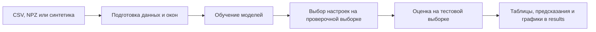

# tsprep

НИР по нейросетевой предобработке экономических временных рядов.
В проекте исследуются исправление ошибок наблюдения, заполнение пропусков
и сжатие окон с помощью AE/VAE. Для проверки пользы предобработки
по полученным данным обучается отдельная модель прогноза.
> AE/VAE - типы энкодера, под капотом использующие разные архитектуры: TCN (Temporal Convolution Network), LSTM, Transformer, Hybrid (TCN + Attention)

## Установка

Python 3.10+, запуск предполагается из корня проекта. Создайте и активируйте виртуальное окружение. Команды установки
и последующего запуска должны выполняться в нём:

```powershell
python -m venv .venv
pip install -e .
# Необязательные инструменты:
pip install -e ".[dev,download,notebook]"
```

Зависимости перечислены в `reqs.txt` и `pyproject.toml`. Каждый эксперимент
сохраняет версии библиотек в своей папке, в `environment.json` или `environment.txt`.

## Заполнение пропусков на NN5

Скачайте `nn5_daily_dataset_with_missing_values.zip` со
[страницы NN5, версия 3](https://zenodo.org/records/4656110) и положите в `data/raw/`.
Это исходный набор с пропусками. Запуск:

```powershell
python -m tsprep.imputation_experiment --data data/raw/nn5_daily_dataset_with_missing_values.zip --out results/my_nn5 --device cpu
```

Программа обучает методы заполнения пропусков, выбирает настройки на проверочной
выборке и оценивает ошибки на тестовой. Отдельно считается прогноз на следующий день.
Параметры по умолчанию: окно 56, выборки 511/112/168 дней, 60 эпох,
две скорости обучения и три инициализации, всего шесть TCN. Обучение идёт на CPU
в один поток.

Окружение эксперимента:

| Компонент | Версия |
|---|---|
| Python | 3.12.4 |
| PyTorch | 2.13.0+cu126, вычисления на CPU |
| NumPy | 2.5.1 |
| Pandas | 3.0.5 |
| scikit-learn | 1.9.0 |

| Что посмотреть после запуска | Файл в `--out` |
|---|---|
| Ошибки заполнения всех методов | `imputation_summary.csv` |
| Результаты отдельного прогноза на следующий день | `forecast_summary.csv` |
| Сравнение ошибок и пример заполнения | `imputation_metrics.png`, `imputation_example.png` |
| Отношения ошибок, интервалы и итог критерия | `decision.json` |
| Настройки, окружение, выбранные модели и завершение | `protocol.json`, `environment.json`, `selection.json`, `complete.json` |

Результаты сохраняются в папку `--out`. Для каждого запуска укажите новую папку.

Для своих данных подготовьте `.npz` с `values` формы `[число рядов, число дней]`:
неотрицательные значения, `NaN` для пропусков, нули сохраняются. Необязательные
поля: уникальные `series_ids` и последовательные ежедневные `dates`.
Число рядов задаётся входным файлом. Для другой длины и сезонности задайте `--train-stop`,
`--val-stop`, `--window`, `--period`; окно и длины двух оценочных периодов должны
быть кратны сезонному периоду. `--help` показывает остальные параметры.
Пропуски восстанавливаются внутри уже доступного окна. На других данных
качество заполнения нужно проверить отдельно.

Для проверки запуска добавьте `--smoke`: TCN будет обучаться одну эпоху.
Проверки кода запускаются командой `python -m unittest discover -s tests -v`.

Направление обработки окна и календарные признаки TCN можно проверить отдельно:

```powershell
python scripts/check_nn5_components.py --data data/raw/nn5_daily_dataset_with_missing_values.zip --out results/nn5_components
```

Сравниваются обычная TCN, проход только слева направо, TCN без синуса и косинуса
дня недели, а также бустинг деревьев. Для каждого варианта TCN обучаются шесть
моделей по 60 эпох. Итоговые ошибки находятся в `summary.csv`, парные интервалы
в `comparisons.json`. Это проверка заполнения пропусков; прогноз здесь не считается.

## Запуск

```powershell
python -m tsprep.cli --model hybrid_vae --epochs 40
python -m tsprep.cli --data csv --csv-path data/raw/aapl.csv --columns "Adj Close" --model tcn_ae
python -m tsprep.comparison_experiment --out results/my_comparison_experiment --epochs 30
python -m tsprep.cli --evaluate results/my_comparison_experiment/aapl/fold_0/tcn_ae_seed42_beta0
```

`--out` задаёт новую папку результатов. Существующий одиночный запуск
не перезаписывается. Сравнение AE/VAE можно продолжить с теми же аргументами,
если настройки и исходники совпадают.

Одиночную модель также можно запустить через `python scripts/run_experiment.py`.
После установки доступны `tsprep-experiment`, `tsprep-comparison`,
`tsprep-download`. Для VAE число эпох должно превышать период разогрева KL (по умолчанию 5).
Используется GPU, если доступен; `--device cpu` выбирает CPU.

В CLI отдельно задаются генерация данных (`--data-seed`, по умолчанию 2026),
начальные веса (`--model-seed`, также `--seed`) и перемешивание окон
(`--loader-seed`). Последний параметр по умолчанию равен параметру модели.
При сравнении разных инициализаций `--seeds` данные `--data-seed` остаются одинаковыми.

## Структура кода

| Модуль | Назначение |
|---|---|
| [cli.py](src/tsprep/cli.py), [experiment.py](src/tsprep/experiment.py) | Аргументы запуска, обучение и оценка одной AE/VAE |
| [comparison_experiment.py](src/tsprep/comparison_experiment.py) | Сравнение AE/VAE на нескольких наборах данных и периодах |
| [imputation_experiment.py](src/tsprep/imputation_experiment.py), [imputation/](src/tsprep/imputation/) | Обучение и оценка заполнения пропусков |
| [denoising_experiment.py](src/tsprep/denoising_experiment.py), [denoising/](src/tsprep/denoising/) | Обучение и оценка исправления наблюдений |
| [representation_experiment.py](src/tsprep/representation_experiment.py) | Сравнение эмбеддингов и прогноза по ним |
| [config.py](src/tsprep/config.py), [denoising/protocol.py](src/tsprep/denoising/protocol.py) | Параметры экспериментов |
| [data_preprocessing/](src/tsprep/data_preprocessing/) | Чтение CSV, проверка данных, преобразования и нарезка окон |
| [models/](src/tsprep/models/) | Архитектуры AE/VAE, модель исправления и модель заполнения пропусков |
| [mlcore/](src/tsprep/mlcore/) | Функции потерь, обучение и выбор весов |
| [evaluation/](src/tsprep/evaluation/) | Ошибки восстановления, прогноз, классификация, аномалии и графики |
| [provenance.py](src/tsprep/provenance.py) | Контрольные суммы, сохранение окружения и архива кода |
| [tests/](tests/) | Проверки вычислений и работы с сохранёнными моделями |



`main()` разбирает аргументы командной строки. В файлах `*_experiment.py`
функция `run_experiment()` проводит эксперимент.
У AE `forward(x)` возвращает `(x_hat, z, mu, logvar)`, у модели исправления
`ResidualTCNDenoiser.forward(x)` возвращает окно `x_hat` исходной длины.
AE обучается через `train_model()`, модель исправления через `fit_candidate()`.
TCN для заполнения пропусков находится в `models/imputer.py`.

## Архитектуры

| Название | Энкодер | Декодер |
|---|---|---|
| tcn_ae / tcn_vae | TCN, среднее по времени | интерполяция начального вектора + TCN |
| lstm_ae / lstm_vae | LSTM, последнее состояние | авторегрессивный LSTM |
| transformer_ae / transformer_vae | Transformer, среднее по времени | неавторегрессивный Transformer |
| hybrid_ae / hybrid_vae | TCN + взвешивание по вниманию | общий декодер TCN |

Hybrid-AE и Transformer-VAE - абляции к шести исходным моделям.
Подача правильного предыдущего значения (teacher forcing) доступна в TrainConfig
только для LSTM и по умолчанию выключена. При проверке и тестировании
всегда используется свободная генерация. Поле восприятия TCN: `1 + 2*(kernel_size-1)*(2**levels-1)`.
Внимание использует только данные внутри окна.

## Данные

Для CSV признаки задаются явно через `--columns`. Числа должны быть
конечными, даты - уникальными и возрастающими. По умолчанию:
логарифм -> первая разность -> Z-нормализация по обучающей выборке.
Для рядов в другой шкале предусмотрен `--no-log-transform`.
Стандартное преобразование рассчитано на выбранные ценовые признаки.

`csv_quality_report` проверяет пропуски, Inf, даты, постоянные признаки и
OHLC-согласованность. Подозрительные котировки автоматически не исправляются.
USD/RUB исключён из стандартного исследования: противоречивые котировки
и нулевой Volume требуют сверки источника. Исходные CSV не изменяются.

Синтетические ряды включают случайное блуждание с GARCH-инновациями, сезонность
и повторяющиеся режимы. Для них известны чистый эталон, наблюдаемый ряд и маска
загрязнений. В эталоне остаются случайные изменения сигнала; из него исключены
только добавленные ошибки наблюдения и аномальные импульсы.
Маска разностей учитывает обе точки вычитания.

Обучение AE по чистому эталону на синтетических данных:

```powershell
.venv/Scripts/python.exe -m tsprep.cli --model tcn_ae --epochs 40 --data-seed 9001 --training-target clean --validation-target clean --selection-metric endpoint_mae
```

В этом режиме нужны парные наблюдаемые и чистые окна. Для обычного CSV
без чистого эталона такая цель обучения недоступна.

## Сравнение AE/VAE

Стандартное сравнение использует синтетику, AAPL (Adj Close) и BTC (Close).
Параметры: окно 48, шаг 2, latent_dim 16, hidden_dim/d_model 32, три уровня TCN,
батч 128, инициализации 42, 43, 44. Тестовые периоды занимают примерно 70-85%
и 85-100% истории и не пересекаются. Обучающие периоды пересекаются.

Для каждого VAE в каждом периоде на первой инициализации сравниваются
$\beta$=0.001 и 0.01 по ошибке восстановления на проверочной выборке.
Выбранный $\beta$ используется и для остальных инициализаций.
Всего выполняются 144 выбранных запуска и 24 дополнительных кандидата
$\beta$, до 30 эпох на обучение. Для $\beta$ проверяются только два указанных значения.

Ошибка восстановления усредняется по B*T*F. KL суммируется по latent_dim
и усредняется по B; $\beta$ задан для этих величин. Веса выбираются по
детерминированному восстановлению через μ, без оценки Monte Carlo ELBO.
Для VAE выбор весов и отсчёт ожидания ранней остановки начинаются после
разогрева KL. Обучение останавливается после 8 последовательных эпох
без достаточного улучшения.

## Метрики и методы сравнения

- $MSE$/$MAE$/$R^2$ в стандартизованной шкале и по признакам. Оконные метрики
  повторно учитывают пересекающиеся точки.
- Прогноз одного будущего преобразованного наблюдения на точном H=5.
  Это не цена и не накопленная доходность за H периодов. Ridge обучается
  на обучающей выборке; коэффициент регуляризации выбирается на проверочной.
- Нулевая реконструкция, PCA той же latent_dim, PCA+Ridge,
  Ridge по исходному окну, среднее и медиана обучающей выборки, последнее преобразованное наблюдение.
- Silhouette с явным источником меток; один истинный режим не подменяется KMeans.
- USREC - ретроспективная классификация. Метки не заполняются из будущего.
  Для одного класса sensitivity/ROC-AUC ограничены или не определены.
- Оценка аномалии: MSE + 0.1*KL; порог - 95-й процентиль проверочной выборки,
  без подбора по тестовым меткам. Отдельно оцениваются концы окон и эпизоды
  на наблюдаемых концах окон.
- Эффективный ранг, active units, KL, дисперсии z. Отношение дисперсий
  зависит от масштаба и не измеряет информацию.
- На синтетике отдельно считается ошибка относительно чистого эталона.

Парные интервалы ошибок рассчитываются с учётом временной зависимости:

```powershell
.venv/Scripts/python.exe scripts/analyze_experiment.py results/my_comparison_experiment
```

Скрипт сохраняет прогнозы, парные интервалы разности ошибок с методами сравнения
и графики PNG/SVG. Для интервалов используется блочный бутстреп: повторная
выборка целых временных блоков. Интервалы условны на выбранных рядах
и протоколе; число временных блоков может быть небольшим.
Сравниваются среднее, медиана, Ridge по исходному окну, PCA+Ridge и последнее наблюдение. При менее
пяти временных блоках или block_len >= N границы интервала отсутствуют с явным
статусом `insufficient_temporal_blocks`; длина блока не обрезается до N.
Для короткого тестового периода BTC интервалы при блоках 24/48/96 не выдаются.
Все производные файлы помещаются в новый каталог анализа; `--out` позволяет
задать его явно. MSE/MAE к чистому эталону и ошибки на нормальных/загрязнённых точках
сохраняются отдельно. В метриках всех элементов окон пересекающиеся точки
учитываются повторно.

## Компактные представления и прогнозирование

```powershell
.venv/Scripts/python.exe -m tsprep.representation_experiment --out results/my_embedding_experiment --device cuda
# Короткая техническая проверка:
.venv/Scripts/python.exe -m tsprep.representation_experiment --smoke --out results/my_embedding_smoke --device cpu
```

Здесь проверяется, помогает ли обучение AE удалению шума получить более полезные
эмбеддинги для прогноза. Используются четыре типа синтетических рядов,
для которых известен чистый эталон.

Сравниваются две одинаковые сети TCN-AE. Обе получают зашумлённое окно,
но обучаются восстанавливать разные значения:

| Модель | Цель обучения |
|---|---|
| Обычный AE | Наблюдаемое зашумлённое окно |
| AE с удалением шума | Чистое окно |

Каждая сеть сжимает окно из 48 значений в эмбеддинг из 8 чисел. Начальные веса
и порядок обучающих окон у двух сетей одинаковы.

После обучения веса энкодера больше не меняются. По полученным 8 числам
обучается Ridge, линейная модель прогноза. Она предсказывает будущее значение
доходности через 7 шагов (H=7).

Для обучения и выбора настроек используются 12 рядов. Качество прогноза
проверяется на 80 новых рядах. AE с удалением шума сравнивается с обычным AE,
PCA-8 и MAD->PCA-8, где перед PCA ряд обрабатывается фильтром MAD.
Вариант `clean_oracle` получает чистый вход и показывает результат с доступным эталоном.

Параметры находятся в `RepresentationProtocol` файла `config.py`.
В `--out` укажите новую папку результатов.

<details>
<summary>Выбор настроек и статистическая оценка</summary>

Цель прогноза: чистая стандартизованная доходность за один шаг Δlog P
в момент t+7.

Каждая модель обучается 120 эпох. Для обеих сетей выбираются веса с наименьшей
MSE восстановления чистого окна на проверочной выборке.

Проверяются две скорости обучения. Для каждой считается отношение MAE прогноза
по эмбеддингам к MAE прогноза по исходному входу. Выбирается одна общая скорость
с наименьшим средним отношением для двух моделей. Сначала выполняются четыре
обучения для выбора скорости, затем ещё четыре с выбранной скоростью и двумя
другими наборами начальных весов. Всего восемь обучений AE; итоговая оценка
использует три инициализации.

Нормализаторы, PCA, статистики MAD и коэффициенты Ridge рассчитываются
только на обучающей выборке. Коэффициент регуляризации Ridge выбирается на проверочной.
Все настройки фиксируются до оценки на новых тестовых рядах.

Для каждого из трёх сравнений считается отношение MAE модели с удалением шума
к MAE метода сравнения. Значение ниже 1 означает меньшую ошибку прогноза.
Основной критерий выполнен, если верхняя односторонняя граница этого отношения
тоже ниже 1 во всех трёх сравнениях. Поправка Bonferroni учитывает проверку
трёх сравнений; используется квантиль `1−0.05/3`.

Границы рассчитываются бутстрепом: повторно выбираются целые ряды внутри каждого
из четырёх типов. Перед этим ошибки трёх инициализаций усредняются для каждого
ряда. Сами прогнозы в ансамбль не объединяются.

На тех же тестовых рядах проверяются уровни ошибок 0/1/2 без дообучения.
Основной критерий относится только к стандартному уровню 1.

</details>

Для просмотра результатов откройте ноутбук 05 и укажите папку в `RESULT`.
В ней сохраняются исходники, данные, веса, эмбеддинги обучающей и проверочной
выборок, коэффициенты Ridge, прогнозы, ошибки восстановления, характеристики z,
сводка и решение по гипотезе.

## Исправление ошибок наблюдения

Для исправления наблюдений используется остаточная TCN. Она сохраняет длину
окна и использует только доступную историю:

```powershell
.venv/Scripts/python.exe -m tsprep.denoising_experiment --out results/my_residual_denoising --device cuda
# Проверка запуска:
.venv/Scripts/python.exe -m tsprep.denoising_experiment --smoke --out results/my_denoising_smoke --device cpu
```

Каталог назначения должен быть новым. При отсутствии CUDA используйте CPU.
До обучения сеть точно копирует вход, затем учится исправлять его по парам
наблюдаемого и чистого окна. При обычном обучении копированию входа ошибка
уже равна нулю. Этот вариант сохраняется отдельно для сравнения.

Сначала проверяется обучение на 32 окнах. Основной опыт включает четыре
семейства синтетики, 12 траекторий для обучения и выбора настроек, три
инициализации и 80 новых траекторий для итоговой проверки. Функция потерь
и скорость обучения выбираются на проверочной выборке. Каждый кандидат
обучается 120 эпох без ранней остановки. Веса выбираются по MAE
на проверочной выборке при ограничении normal MSE/input <= 1.05. Если
подходящих весов нет, остаётся исходное копирование входа. Нормализация
обучается только на обучающих частях исходных траекторий.

Для сравнения используются исходный вход, среднее обучающей выборки, PCA,
медианный фильтр, фильтр Хампеля и замена больших отклонений от обучающей медианы
по порогу MAD. Медианный фильтр и фильтр Хампеля используют только прошлое
и текущую точку. Параметры фильтров и Ridge для отдельного прогноза H=7
выбираются до итоговой проверки.
Прогнозируется чистая логарифмическая доходность точно на H=7, не цена и не
суммарная доходность. Для Ridge используются последние 16 значений из окна 48;
для них доступно полное поле восприятия TCN.

Сохраняются настройки, исходники, данные с контрольными суммами, веса, история
обучения, выбранные параметры, CSV с ошибками концов окон и прогнозов,
проверка чистого входа, предсказания, PNG и запись о завершении с контрольными
суммами. В `decision.json` находятся парные бутстреп-интервалы
по независимым траекториям; семейства имеют равный вес.
Повторы инициализации усредняются внутри траектории; ансамбль не используется.
Основной критерий для верхних односторонних границ 97.5%: MAE/input < 1 и
normal MSE/input <= 1.05. Сравнения с остальными методами носят описательный характер.

`06_residual_denoising_experiment.ipynb` показывает результаты этого опыта.

<details>
<summary>Параметры проверки сохранности сигнала и обработки с задержкой</summary>

Вариант `mse_identity` добавляет сохранение чистого входа:
`MSE(f(observed)[-1], clean[-1]) + λ * MSE(f(clean)[-1], clean[-1])`.
Оба слагаемых оценивают последнюю точку окна. При λ=0 это обычный MSE;
при λ>0 нужны дополнительный расчёт выхода и градиентов по чистому окну.
λ и скорость обучения выбираются только на проверочной выборке; инициализация и порядок
батчей совпадают с контрольным MSE.

```powershell
.venv/Scripts/python.exe -m tsprep.denoising_experiment --out results/preservation_control --device cuda --loss mse --family-guard --transfer-checks --development-seeds 18001 18002 18003 --confirmation-seeds (102001..102020)
.venv/Scripts/python.exe -m tsprep.denoising_experiment --out results/preservation_identity --device cuda --loss mse_identity --identity-weights 0.1 1 10 --family-guard --transfer-checks --development-seeds 18001 18002 18003 --confirmation-seeds (102001..102020)
```

В парном протоколе `residual_preservation_v1` используются указанные
в командах параметры генераторов. Для проверки изменённого метода нужны новые
тестовые траектории. Контроль перебирает две скорости обучения, а новый вариант
функции потерь три λ × две скорости. У второго варианта больше кандидатов. Каждый кандидат проходит 120 эпох,
затем выбранные параметры проверяются ещё на двух инициализациях.

`--family-guard` проверяет normal MSE/input <= 1.05 для каждого семейства
при выборе весов и методов сравнения. В итоговой проверке требуется
MAE/input < 1 в среднем и соблюдение ограничения в каждом семействе.
Для четырёх семейств используются односторонние 99% бутстреп-границы
(Bonferroni на пять критериев). Если улучшения с такими ограничениями нет,
остаётся копирование входа. Такой вариант не снижает ошибку входа.

Порог крупных чистых движений — 95-й перцентиль абсолютных нормализованных
чистых доходностей на обучающей выборке отдельно по семействам. `endpoint_metrics.csv`
дополняется `large_*` и `large_normal_*`; normal означает отсутствие
импульсной ошибки в двух соседних ценах; гауссов шум наблюдения при этом может оставаться.
`--transfer-checks` дополнительно сохраняет `transfer_metrics.csv`,
`transfer_summary_by_family.csv` и прогнозы на чистом входе, мелких частых,
крупных редких и четырёхточечных ошибках уровня цены. Чистая динамика одинакова
между условиями; настройки моделей и фильтров заморожены. Эти проверки
описательные, не используются для выбора λ. Четырёхточечная ошибка котировки
не описывает настоящий экономический скачок. Прогноз H=7 остаётся
дополнительной проверкой.

В протоколе `residual_validation_v1` можно проверить выбор настроек
на отдельных траекториях. `--validation-seeds` задаёт траектории, независимые
от обучающих и тестовых; их число должно совпадать с числом `--development-seeds`.
Используется заключительная часть каждой такой траектории. Эти значения
не участвуют в нормализации и обучении сети. Параметр `--volatility-scales 0.5 1 2`
циклически назначает масштабы чистых логарифмических доходностей траекториям
обучения и выбора настроек. Число траекторий должно делиться на число масштабов.
Масштабируются и сезонные компоненты, а ошибки наблюдения сохраняют амплитуду.
К одной траектории применяется один множитель масштаба.

При `--family-guard` ограничение на проверочной выборке применяется к каждой паре
«семейство × масштаб», чтобы низкая волатильность не скрывала повреждение
высокой. `--validation-upper-quantile 0.99` заменяет среднее в этом ограничении
верхней бутстреп-границей по независимым проверочным траекториям.
Это правило выбора, а не одновременная статистическая гарантия для всех эпох.
Если ни один набор весов не проходит ограничение и не улучшает MAE,
сохраняется эпоха 0 с копированием входа. В этом случае допустимого улучшения нет.
В истории сохраняются отношения ошибок по траекториям, а в `validation_panel.json` параметры генераторов,
масштабы и размеры сегментов. Для фиксации гиперпараметров можно указать
`--loss mse_identity --identity-weights 0.1 --learning-rates 0.001`.

Итоговая проверка основного критерия остаётся на масштабе 1. При `--transfer-checks`
для остальных масштабов дополнительно проверяются загрязнённые и полностью
чистые траектории; веса при проверке остаются фиксированными.

Отдельная гипотеза `residual_local_context_v1` добавляет TCN признаки локального
масштаба: `--local-context 16 --window 64 --context-mode local`.
На каждом шаге используются текущий вход, медиана предыдущих 16 наблюдений,
log робастного масштаба `max(1.4826*MAD, 0.001)` и локальное отклонение,
ограниченное диапазоном [-20,20]. Медиана/MAD не включают текущую точку;
используется нижняя медиана через стабильную сортировку. Начальная история дополнена нулями,
но проверка поля восприятия исключает эту область для конца окна и всех
16 прогнозных признаков. Коррекция остаётся в исходных нормализованных единицах.

`--context-mode repeat` подаёт четыре копии входа как контроль с тем же числом
параметров и теми же начальными весами. Он не добавляет информации о масштабе.
Для обоих вариантов одинаковы окно 64, функция потерь, λ, скорость обучения,
параметры генераторов, проверочная выборка и бюджет.
Опция `local_context=0` отключает локальные признаки. При загрузке весов
используются `local_context` и `context_mode` из сохранённого протокола.

Протокол `residual_delay_v1` проверяет пользу одного дополнительного наблюдения:
`--correction-delay 1 --window 64 --delay-mode past` задаёт контроль,
`--delay-mode next` — исправление с дополнительным наблюдением.
В общий момент оценки `s` оба варианта восстанавливают `clean[s-1]`.
TCN получает два потока: `observed[s-1]` и его копию в контрольном режиме past
либо `observed[s]` в режиме next. Начальные веса и число параметров совпадают.
История до исправляемой точки одинакова; next добавляет ровно одно наблюдение.
Режим past мог бы выдать оценку раньше, но здесь он сравнивается в общем
моменте `s`. Исправление выдаётся с задержкой на одно наблюдение.
Задержка и `local_context` используются раздельно.

`endpoint_index` указывает исправляемую точку, `availability_index` — момент
доступности данных; в режиме delay=1 их разность равна 1. Чистый эталон
и маски конца окна, обычных и загрязнённых точек привязаны к первой, а прогноз H=7 ко второй:
прогнозируется `clean[s+7]`, а не `clean[(s-1)+7]`. В предсказаниях сохраняется
`forecast_origin_index`. Метод сравнения `observed_input` использует сырой
ряд до `s-1`, дополнительный `raw_available` — все последние 16 наблюдений
до `s`. Результат сравнивается также с raw_available.

Дополнительно сравниваются медиана трёх значений вокруг исправляемой точки
и `delayed_pair`: противоположные большие соседние доходности заменяются
их средним, если обе выходят за порог медианы/MAD предыдущих 16 точек
и их сумма не больше трёх локальных масштабов. Порог 3/5/7/9 выбирается
только на проверочной выборке.
Оба метода используют максимум одно следующее наблюдение. Для PCA разрешено
всё окно, доступное в момент `s`; значений после `s` нет ни в одном методе.
При `correction_delay=0` исправляется текущая последняя точка без задержки.

</details>

## Сохранение результатов

У одиночной AE/VAE настройки и обученный нормализатор записываются в `manifest.json`,
веса в `model.pt`, входные данные в `input.npz`, метрики в `metrics.json`.
Сравнение AE/VAE сохраняет `comparison_runs.csv` и `comparison_summary.csv`.

В опытах с исправлением и эмбеддингами `protocol.json` содержит настройки,
`selection.json` выбранные параметры, `summary.csv` ошибки, а `decision.json`
результат проверки критерия. Для NN5 названия выходных таблиц приведены выше.
`complete.json` записывается после завершения эксперимента и содержит контрольные суммы.
Исходники и окружение сохраняются в `source.zip` и файле `environment.json` или `environment.txt`.

При загрузке проверяются контрольные суммы данных, весов и исходников.
Нормализатор используется из сохранённой модели. Для чтения метрик другой
версией кода предусмотрен `allow_source_mismatch=True`; контрольные суммы
и связь с manifest проверяются и в этом режиме. Продолжение сравнения
требует совпадения настроек и исходников.

## Ноутбуки

| Файл | Назначение |
|---|---|
| `01_data_preparation.ipynb` | Данные, предобработка, разметка и пары окон с целевыми значениями |
| `02_model_zoo_smoke_test.ipynb` | Размеры выходов моделей, функции потерь и градиенты |
| `03_training_and_comparison.ipynb` | Обучение и сравнение AE/VAE |
| `04_evaluation_and_results.ipynb` | Таблицы и графики сохранённого сравнения |
| `05_denoising_comparison.ipynb` | Эмбеддинги обычного AE и AE с удалением шума |
| `06_residual_denoising_experiment.ipynb` | Исправление ошибок наблюдения остаточной TCN |

В ноутбуках 05 и 06 задайте `RESULT` с папкой своего эксперимента.
Команды обучения приведены в разделах про эмбеддинги и исправление наблюдений. В ноутбуке 05
`MODE="embeddings"` читает результаты полного опыта,
а `MODE="pilot"` запускает небольшой опыт на одной траектории с параметром
генерации данных 9001 и ранней остановкой.

## Тесты

```powershell
.venv/Scripts/python.exe -m unittest discover -s tests -p "test_*.py" -v
# При установленном dev extra:
.venv/Scripts/python.exe -m pytest -q
```

Проверяются преобразования данных, границы выборок, градиенты, выбор весов,
сохранение и загрузка моделей, метрики и воспроизводимость небольших запусков.
